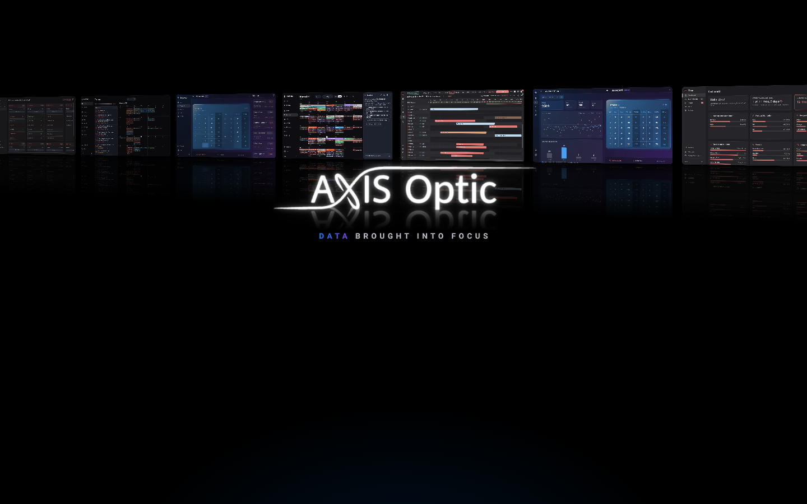
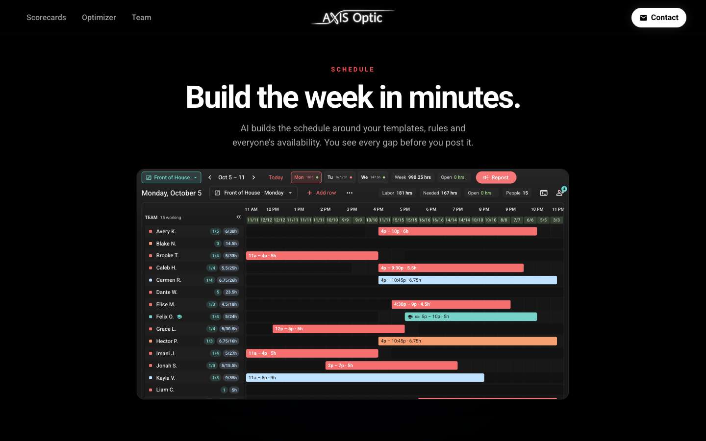

# Axis Optic — Company Website

The marketing site for **Axis Optic** and its first product, **Axis Optic: Team**, a scheduling and shift-operations platform for quick-service restaurants.

**Live site:** [axisoptic.com](https://axisoptic.com)



## Overview

A single-page site that introduces the company and walks visitors through the Team product in a series of full-screen, scroll-driven scenes. The product screens are not images: they are small HTML/CSS recreations of the real app's interface, laid out at the app's actual dimensions and scaled to fit, so they stay sharp at every size and can animate.

| Schedule scene | Multi-store settings scene |
| --- | --- |
|  |  |

## Features

- **Animated logo intro.** The wordmark's horizontal line is generated in JavaScript so its tips always end just inside the screen edges, and it is rebuilt on resize.
- **Scroll-pinned scenes.** Each section stays pinned while you scroll through it, and the product shot rises, straightens and fades. Scroll progress is mapped directly to CSS custom properties, so fast scrolling never skips a step.
- **Live product previews.** Recreations of the schedule, dashboard and multi-store settings screens play when they come into view.
- **Phone app gallery.** Cross-fading phone screens with chapter tabs that fill as each preview plays. Supports clicking, arrow keys and swiping.
- **Smooth motion.** Animations use only `transform` and `opacity`, so the page never reflows mid-scroll, and they respect `prefers-reduced-motion`.

## Built with

- HTML, CSS and vanilla JavaScript, with no framework and no build step
- [Firebase Hosting](https://firebase.google.com/docs/hosting) for deployment
- Google Fonts (Roboto)

## Project structure

```
public/
  index.html        page markup and scripts
  styles.css        all styles (colors match the Axis Optic: Team app)
  assets/           logo, product icon, favicons
docs/screenshots/   images used in this README
firebase.json       hosting config (clean URLs, cache headers)
deploy_website.command   one-click deploy script for macOS
```

## Running locally

No install is needed. Open `public/index.html` in a browser, or serve the folder:

```bash
npx serve public
```

## Deployment

```bash
firebase login
firebase deploy --only hosting
```

On macOS you can also double-click `deploy_website.command`.

## How it was built

This project was built with AI-assisted development. I designed the site and directed the work, and I used **Claude** (Anthropic) and **Gemini** in **Google Antigravity** to write and iterate on the code. The commit history was rebuilt from dated snapshots of the project, so it shows how the site changed over time.

## Status

**Current version: 1.0.0.** See the [changelog](CHANGELOG.md) for version history.

The site is live. Axis Optic: Team is currently at the concept stage. Team messaging and more products are planned.

## License

The source code is available under the [MIT License](LICENSE). The Axis Optic name, logos and product designs are not covered by the license and may not be reused.
