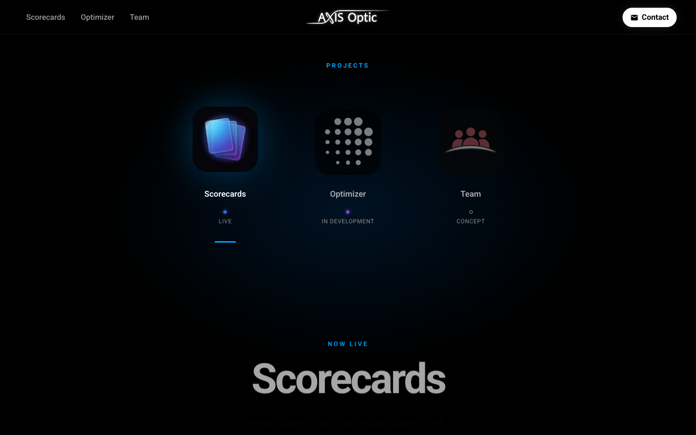
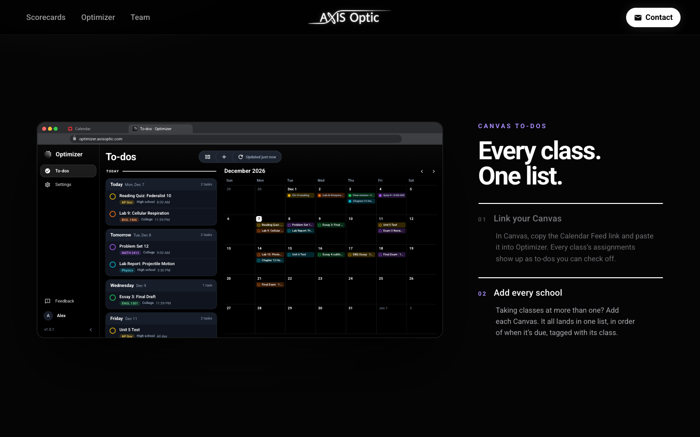
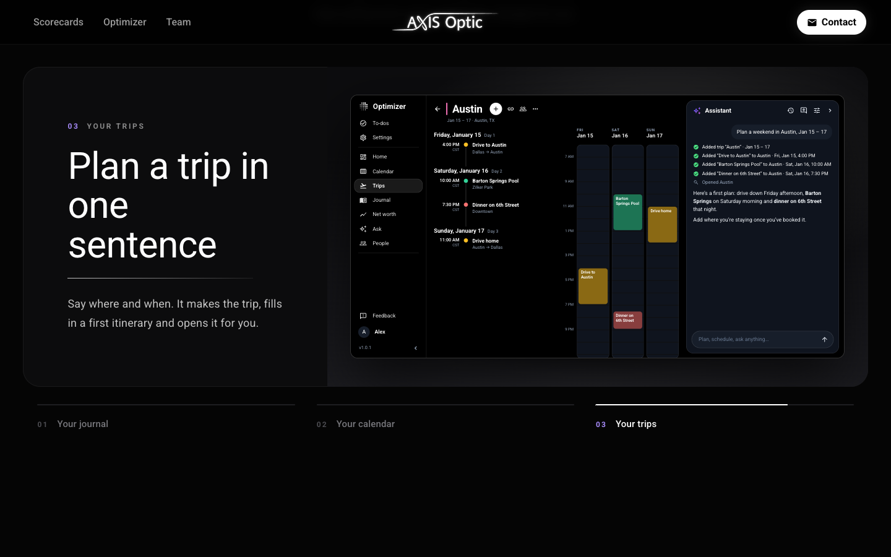
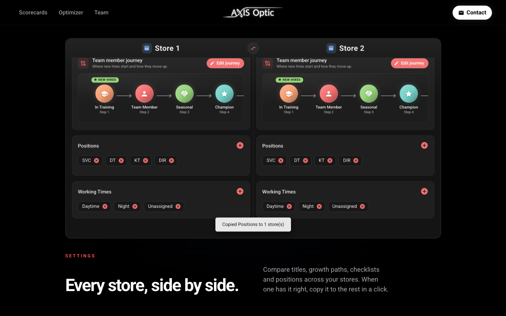

# Axis Optic — Project Portfolio

A portfolio site for **Axis Optic** and its three projects: **Scorecards**, a score-keeping app for card and board games; **Optimizer**, a personal command center for calendars, to-dos, trips, journal and finances; and **Axis Optic: Team**, a scheduling and shift-operations platform for quick-service restaurants.

**Live site:** [axisoptic.com](https://axisoptic.com)


## Overview

A single-page site that walks visitors through each project in a series of full-screen, scroll-driven scenes, each with its own layout and entrance. The app screens are not images: they are small HTML/CSS recreations of the real app's interface, laid out at the app's actual dimensions and scaled to fit, so they stay sharp at every size and can animate.

| Projects | Scorecards scoring scene |
| --- | --- |
|  |  |
| **Optimizer Canvas to-dos scene** | **Optimizer assistant gallery** |
|  |  |
| **Team schedule scene** | **Team multi-store settings scene** |
|  |  |

## Features

- **3D hero intro.** A camera flies along a wall of app screens, turns, and settles on the Axis Optic logo as its line, X and letters draw in, over "Data brought into focus". It's all CSS 3D transforms on a 1584 × 396 banner scaled to the screen, plays once, and pauses while the tab is in the background.
- **Docking top bar.** The top bar isn't there at the top of the page. Scrolling down, the hero's logo shrinks into the middle of the bar, then the links and Contact fade in. The motion uses scroll-driven animations (a `ScrollTimeline`), so it stays in step with the scroll however fast you go, with a script fallback for browsers without them.
- **App switcher.** The Projects section shows each app as its icon, side by side, with its name and status. Clicking one (or using the arrow keys, swiping, or the top-bar links) lights it up and shows only that app's page below. Each page sets its own accent colors and backdrop.
- **Live version badges.** Each app's version is read from the `version.json` file its Flutter web build publishes, so the site always shows the current release without being edited. Each app's hosting has to allow `https://axisoptic.com` to read that file (an `Access-Control-Allow-Origin` header on `/version.json`).
- **Scroll-pinned scenes with varied layouts.** Each section stays pinned while you scroll through it. Each scene enters differently: rising, swinging in from the side, pulling back from a zoom, flattening from a 3D tilt, landing like a tossed card, or pairing a desktop window with a phone. Scroll progress is mapped directly to CSS custom properties, so fast scrolling never skips a step.
- **Live app previews.** Recreations of the Team schedule, dashboard and settings screens, and the Scorecards screens, play when they come into view. The Scorecards ones are rebuilt from the real app: scoring and posting a game while a friend's phone gets the notification and opens it from Mail, the metrics page and its score chart, and adding people with the app's own dialogs and invite link.
- **Optimizer page.** A Canvas to-dos scene shows a student copying their Canvas calendar feed into Optimizer, then every school's assignments landing in one list, with numbered steps that fill as it plays. "Not available yet." introduces the concept features: an assistant gallery (it sums up a journal, schedules a week and plans a trip, opening it with its itinerary and day tiles), then Net worth, Journal and Trips, shown on the computer with a phone beside it (Trips on the computer alone).
- **Phone app galleries.** Cross-fading phone screens for each app (desktop windows for Optimizer's assistant), with chapter tabs that fill as each preview plays. Supports clicking, arrow keys and swiping.
- **Smooth motion.** Animations use only `transform` and `opacity`, so the page never reflows mid-scroll, and they respect `prefers-reduced-motion`.

## Built with

- HTML, CSS and vanilla JavaScript, with no framework and no build step
- [Firebase Hosting](https://firebase.google.com/docs/hosting) for deployment
- Google Fonts (Roboto)

## Project structure

```
public/
  index.html        page markup and scripts
  styles.css        all styles (each app's page has its own theme)
  assets/           logos, app icons, favicons
  assets/hero/      the hero intro's app screens and backdrop
docs/screenshots/   images used in this README
firebase.json       hosting config (clean URLs, cache headers)
deploy_website.command   one-click deploy script for macOS
```

## Running locally

No install is needed. Open `public/index.html` in a browser, or serve the folder:

```bash
npx serve public
```

## Deployment

The site is hosted on Firebase Hosting in its own project, Axis Optic (`axis-optic-ce4f2`, set in `.firebaserc`).

```bash
firebase login
firebase deploy --only hosting
```

On macOS you can also double-click `deploy_website.command`.

## How it was built

This project was built with AI-assisted development. I designed the site and directed the work, and I used **Claude** (Anthropic) and **Gemini** in **Google Antigravity** to write and iterate on the code. The commit history was rebuilt from dated snapshots of the project, so it shows how the site changed over time.

## Status

**Current version: 1.7.0** (also shown in the site's footer). See the [changelog](CHANGELOG.md) for version history.

The site is live. Scorecards is live at [scorecards.axisoptic.com](https://scorecards.axisoptic.com), Optimizer is in development, and Axis Optic: Team is a concept.

## License

The source code is available under the [MIT License](LICENSE). The Axis Optic and Scorecards names, logos and product designs are not covered by the license and may not be reused.
