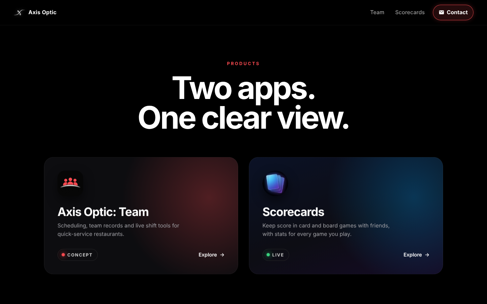
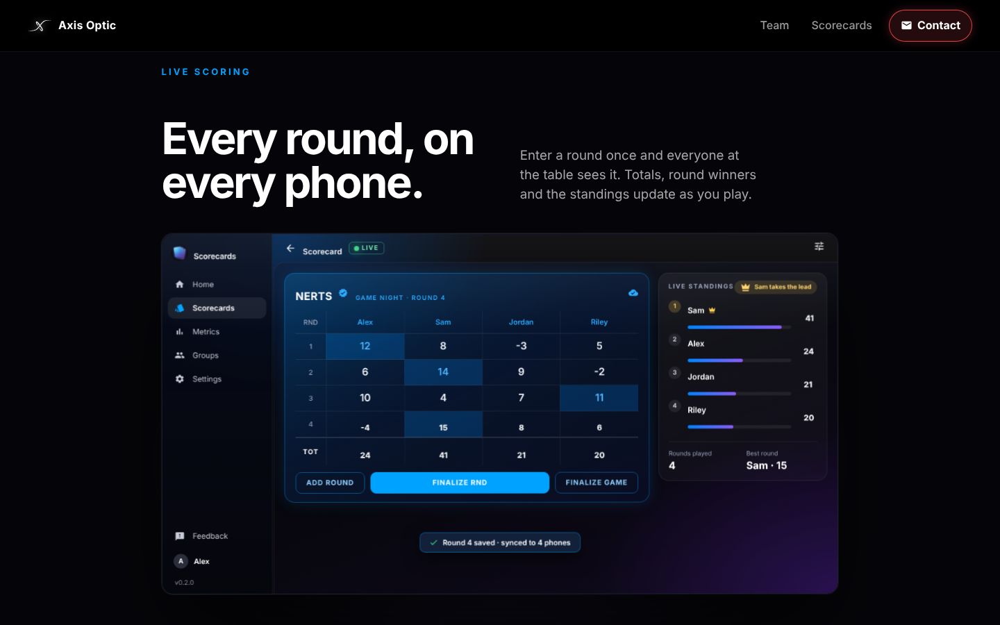

# Axis Optic — Company Website

The marketing site for **Axis Optic** and its two products: **Scorecards**, a score-keeping app for card and board games, and **Axis Optic: Team**, a scheduling and shift-operations platform for quick-service restaurants.

**Live site:** [axisoptic.com](https://axisoptic.com)


## Overview

A single-page site that introduces the company and walks visitors through each product in a series of full-screen, scroll-driven scenes, each with its own layout and entrance. The product screens are not images: they are small HTML/CSS recreations of the real app's interface, laid out at the app's actual dimensions and scaled to fit, so they stay sharp at every size and can animate.

| Products | Scorecards live scoring scene |
| --- | --- |
|  |  |
| **Team schedule scene** | **Team multi-store settings scene** |
|  |  |

## Features

- **Animated logo intro.** The wordmark's horizontal line is generated in JavaScript so its tips always end just inside the screen edges, and it is rebuilt on resize.
- **Two products, one page.** A products section links to each app's own block, and each block sets its own accent colors and backdrop.
- **Live version badge.** The Scorecards version is read from the `version.json` file the Flutter web build publishes, so the site always shows the current release without being edited.
- **Scroll-pinned scenes with varied layouts.** Each section stays pinned while you scroll through it. The six scenes each enter differently: rising, swinging in from the side, pulling back from a zoom, landing like a tossed card, flattening out of a 3D tilt, or pairing a desktop window with a phone. Scroll progress is mapped directly to CSS custom properties, so fast scrolling never skips a step.
- **Live product previews.** Recreations of the Team schedule, dashboard and settings screens, and the Scorecards live scoring, metrics and invite-a-friend screens, play when they come into view.
- **Phone app galleries.** Cross-fading phone screens for each product, with chapter tabs that fill as each preview plays. Supports clicking, arrow keys and swiping.
- **Smooth motion.** Animations use only `transform` and `opacity`, so the page never reflows mid-scroll, and they respect `prefers-reduced-motion`.

## Built with

- HTML, CSS and vanilla JavaScript, with no framework and no build step
- [Firebase Hosting](https://firebase.google.com/docs/hosting) for deployment
- Google Fonts (Roboto)

## Project structure

```
public/
  index.html        page markup and scripts
  styles.css        all styles (each product block has its own theme)
  assets/           logos, product icons, favicons
docs/screenshots/   images used in this README
firebase.json       hosting config (clean URLs, cache headers)
deploy_website.command   one-click deploy script for macOS
```

## Running locally

No install is needed. Open `public/index.html` in a browser, or serve the folder:

```bash
npx serve public
```

## Deployment

```bash
firebase login
firebase deploy --only hosting
```

On macOS you can also double-click `deploy_website.command`.

## How it was built

This project was built with AI-assisted development. I designed the site and directed the work, and I used **Claude** (Anthropic) and **Gemini** in **Google Antigravity** to write and iterate on the code. The commit history was rebuilt from dated snapshots of the project, so it shows how the site changed over time.

## Status

**Current version: 1.1.0.** See the [changelog](CHANGELOG.md) for version history.

The site is live. Scorecards is live at [scorecards.axisoptic.com](https://scorecards.axisoptic.com), and Axis Optic: Team is in development.

## License

The source code is available under the [MIT License](LICENSE). The Axis Optic and Scorecards names, logos and product designs are not covered by the license and may not be reused.
